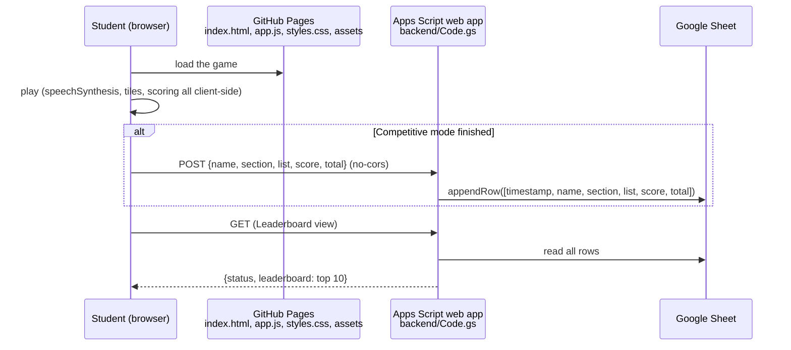

# Spelling Adventure

A browser spelling game for young students: look at a picture, hear the word, and build it from scrambled letter
tiles. Includes English and Spanish word lists and an optional class leaderboard backed by Google Apps Script.

## Description

Spelling Adventure is a static web app (plain HTML, CSS and JavaScript, no build step) meant for an early primary
classroom. Each round shows an illustration, speaks the word aloud with the browser's text-to-speech, and asks the
student to tap letters into the answer slots. Teachers can use it for free practice, for an ungraded self-test, or in a
competitive mode where each student's result is saved to a Google Sheet and shown on a top-10 leaderboard.

The frontend is published with GitHub Pages under a custom domain (see `CNAME`); the backend is a Google Apps Script
web app bound to a spreadsheet.

## Features

- Two word lists: **English** (11 words) and **Spanish** (8 words, consonant blends such as *bl* and *br*), each word
  with its own illustration in `assets/images/`.
- Word pronunciation through the Web Speech API (`speechSynthesis`), in `en-US` or `es-ES`, played automatically and
  on demand.
- Letter bank with the word's letters plus two random extra letters, shuffled; tap a tile to place it, tap a slot to
  remove it.
- Three modes:
  - **Practice**: immediate feedback with sounds (Web Audio API) and animations; the word must be correct to advance.
  - **Test**: no feedback, every answer advances, final score at the end.
  - **Competitive**: like Test, but asks for the student's name and class section first and saves the result.
- Final score screen with confetti.
- Leaderboard view: top 10 results, ordered by score (descending) and then by time (earliest first).

## Architecture



## Requirements

- Any modern browser. Text-to-speech voices depend on the browser and OS; a Spanish voice must be installed for the
  Spanish list to sound right.
- For the leaderboard backend only: a Google account, a Google Sheet, and optionally
  [clasp](https://github.com/google/clasp) (`npm install -g @google/clasp`) to push `backend/` from the command line.

## Installation and quick start

The frontend has no dependencies. Serve the folder with any static server:

```bash
git clone https://github.com/Lapeyus/SpellingGame.git
cd SpellingGame
python3 -m http.server 8000
# open http://localhost:8000
```

Practice and Test modes work fully offline from the backend. Competitive mode and the leaderboard call the Apps
Script URL configured in `app.js`.

### Setting up your own backend

1. Create a Google Sheet. Put a header row in the first sheet, for example
   `Timestamp | Name | Section | List | Score | Total` (the script skips row 1 when building the leaderboard).
2. Open **Extensions > Apps Script** from that sheet, so the script is bound to it, and paste `backend/Code.gs`
   (and `appsscript.json` if you show the manifest). Alternatively, with clasp, replace the IDs in
   `backend/.clasp.json` with your own script and run `clasp push` from `backend/`.
3. **Deploy > New deployment > Web app**, executing as yourself, with access for anyone (this is what
   `appsscript.json` declares).
4. Copy the `/exec` URL and set it in **both** `scriptUrl` constants in `app.js` (`saveScore` and
   `loadLeaderboard`).

## Usage

1. Choose a mode (Practice, Test or Competitive) on the main menu.
2. Pick the English or Spanish list.
3. For each picture, listen (speaker button), tap letters into the slots and press **Check** (Practice) or
   **Submit** (Test / Competitive).
4. In Competitive mode, enter a name and pick a section first; the score is saved when the list ends.
5. Open **Leaderboard** from the menu to see the top 10.

### Backend API

`backend/Code.gs` exposes:

- `POST` with a JSON body `{ "name", "section", "list", "score", "total" }`: appends one row. Returns
  `{ "status": "success" }` or `{ "status": "error", "message": ... }` if a field is missing.
- `GET`: returns `{ "status": "success", "leaderboard": [ { timestamp, name, section, list, score, total }, ... ] }`
  with at most 10 entries.

## Repository structure

```
.
├── index.html            # all views: menu, game, score, leaderboard, login modal
├── app.js                # word lists, game logic, speech, sounds, backend calls
├── styles.css            # styling and animations
├── assets/images/        # one illustration per word (word_<word>.png) + favicon.png
├── backend/
│   ├── Code.gs           # Apps Script web app: doPost (save), doGet (leaderboard), doOptions
│   ├── appsscript.json   # manifest: V8 runtime, web app executes as deployer, anonymous access
│   └── .clasp.json       # clasp project binding (script ID of the original deployment)
└── CNAME                 # custom domain for GitHub Pages
```

## Configuration

There are no environment variables. Everything is edited in code:

- `lists` in `app.js`: the word lists. Each entry is `{ word, img, lang }`; add the matching image to
  `assets/images/`. To add a new list, add a key to `lists` and a button that calls `startGame('<key>')` in
  `index.html`.
- `scriptUrl` in `app.js` (two places): the Apps Script web app URL.
- Section options: the `<select id="studentSection">` in `index.html`.
- `backend/.clasp.json`: the Apps Script project to push to.
- `CNAME`: the GitHub Pages custom domain. Remove or change it in a fork.

Nothing secret is stored in the repository; the spreadsheet holding student results lives only in the deployer's
Google account.

## Tests

There are no automated tests.

## Deployment

- **Frontend**: GitHub Pages from the repository root of the default branch, with the domain in `CNAME`. Pushing to
  the branch publishes the site.
- **Backend**: `clasp push` from `backend/`, then create a new web app deployment (or update the existing one) in the
  Apps Script editor. A new deployment changes the `/exec` URL, which must then be updated in `app.js`.

## Project status

**Working, recently built.** Built and deployed in a single day; all 15 commits are from 2026-02-19, with no activity since.

Known limitations:

- Score saving uses `mode: 'no-cors'`, so the browser cannot read the response; the app always reports
  "Score saved successfully!" unless the network request itself fails.
- The leaderboard inserts names and sections with `innerHTML` without escaping. Since anyone can POST to the web app,
  a crafted name could inject markup into other players' leaderboard view.
- The Apps Script URL is duplicated in two functions.
- Words are presented in a fixed order, not shuffled.
- The leaderboard mixes both lists and all sections; it does not filter by list.
- The web app is open to anonymous writes; there is no rate limiting or authentication.
